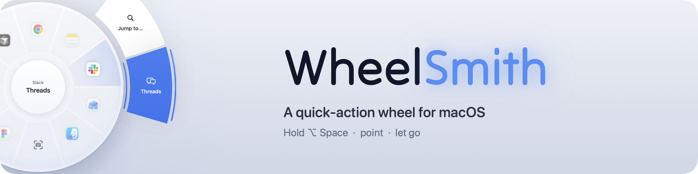

<p align="center">
  <picture>
    <source media="(prefers-color-scheme: dark)" srcset="docs/banner/banner-graphite-dark.png">
    
  </picture>
</p>

WheelSmith is a quick-action wheel for macOS. Hold a hotkey anywhere and a wheel opens under
your cursor. Point at a slice and let go to switch to an app, open a link, click a menu command,
send a shortcut or run a script. Each slice can fan out into an outer ring of sub-actions, and the
whole wheel is set up in a visual editor.

## Quick start

### Requirements

- macOS 14 or later, on Apple Silicon or Intel.

### Download & install

With [Homebrew](https://brew.sh):

```bash
brew tap maitre-pangolin/tap
brew trust --cask maitre-pangolin/tap/wheelsmith
brew install --cask maitre-pangolin/tap/wheelsmith
```

Homebrew only loads casks from other people's taps once you trust them, hence `brew trust`.

Or by hand: download `WheelSmith-<version>.zip` from the
[latest release](https://github.com/Maitre-Pangolin/WheelSmith/releases/latest), unzip it and drag
**WheelSmith.app** into **Applications**.

Then, the first time:

1. Open WheelSmith. It isn't notarized, so macOS blocks it: click **Done**, go to
   **System Settings → Privacy & Security** and click **Open Anyway** next to WheelSmith. Or run:

   ```bash
   xattr -dr com.apple.quarantine /Applications/WheelSmith.app
   ```

2. Grant **Accessibility** when asked (or later in **Settings → General → Grant…**). The wheel
   works without it, but Menu and Shortcut actions, the window picker and **Add from menus** need it.

WheelSmith starts at login from then on. To update, run `brew upgrade --cask wheelsmith`, or quit
WheelSmith from the menu bar and replace the app; then open it again. The Accessibility permission
carries over.

### How to use

- **Open the wheel:** hold **⌥ Space**, point at a slice, let go. Letting go in the center, past
  the edge or pressing **Esc** cancels. You start with apps that come with macOS (Safari, Mail,
  Calendar, Finder, Notes, Terminal…) and a Screenshot slice.
- **Sub-actions:** hover a slice and its sub-actions fan out around it. Keep moving outwards and let
  go on one.
- **Configure:** open **Settings** from the menu-bar icon, or hold the wheel open for two seconds
  (a ring fills around the center) and let go in the center. Click a slice in the live preview to
  edit it. You can change the hotkey in **Settings → General**.
- **Change theme quickly:** while the wheel is open, press **← →** to step through themes and
  **↑ ↓** to switch between light and dark. The choice is saved.

## Features

### Slices and sub-actions

The wheel holds up to 10 slices, clockwise from the top. Each slice can have up to 5 sub-actions in
an outer ring. Letting go on a slice runs its own action; letting go further out runs the
sub-action under the pointer.

### Actions

| Action | What it does |
|---|---|
| **App** | Focuses the app, launching it if needed, like a Dock click. |
| **URL** | Opens a URL, deep link (`slack://…`) or file path, optionally in a chosen app. |
| **Menu** | Focuses an app and clicks one of its menu-bar items, such as *Shell › New Tab*. Needs no shortcut and works with any keyboard layout. |
| **Shortcut** | Focuses an app and sends a keyboard shortcut, such as ⌘T. |
| **Shell** | Runs a command. |
| **Prompt** | Keeps the wheel open with a text field. Type, press Return, and a command runs with your text as `$1`. Good for quick notes, todos or searches. |
| **None** | A slice that only groups sub-actions. |

### Discover sub-actions from menus

Select a slice in Settings and click **Add from … menus**. WheelSmith reads that app's menu bar and
lists every command with its shortcut. Search, tick up to 5, and each becomes a sub-action with a
matching icon.

The menu bar is the one place every macOS app lists its commands, which is why it's the default
source. Keyboard shortcuts and URL schemes work through the Shortcut and URL actions, and
AppleScript through a Shell action with `osascript`.

### Windows and displays

- **Windows come to you:** picking an app (or one of its windows) brings the window to the display
  where you opened the wheel, resized to fit.
- **Window picker:** when an app has two or more windows, its outer ring lists them first, with a
  display badge, minimized ones dimmed and full-screen ones marked. Picking a window on another
  Space switches to it.
- **Near a screen edge** the wheel shifts inward so every slice stays visible.

### Themes

31 themes, light and dark, from soft glass to neon signs, arcade cabinets and carved gold, each
with its own typography. Pick one in **Settings → General**, or switch from the open wheel with the
arrow keys. **↑ ↓** jumps to the matching light or dark theme when there is one, like Neon Sign ↔
Highlighter.

### Configuration file

Everything in Settings is saved to `~/.config/wheelsmith/config.json`. You can edit it by hand;
changes apply as soon as you save. If the JSON is invalid, WheelSmith keeps the previous config and
shows ⚠︎ in the menu bar.

**Settings → Reset** brings back the starter wheel. For a full ten-slice wheel with third-party apps,
sub-actions and a prompt, copy [`examples/config.json`](examples/config.json) over your config.

On first launch, when there's no config yet, WheelSmith writes a starter wheel built from apps that
come with macOS: Safari, Mail, Calendar, Finder, Screenshot, Notes, Terminal and System Settings.
Any of those your Mac doesn't have are left out. **Settings → Reset** brings that wheel back.
For a full ten-slice wheel with third-party apps, sub-actions and a prompt, see
[`examples/config.json`](examples/config.json); copy it over your config to try it.

```jsonc
{
  "hotkey": "option+space",          // modifiers: cmd, option, control, shift; key: a char, space, f1…f20, …
  "theme": "midnight",               // any theme id, e.g. graphite, aurora, neon-sign
  "items": [                         // up to 10, clockwise from the top
    {
      "label": "Terminal",
      "action": { "type": "app", "bundleId": "com.apple.Terminal" },
      "children": [                  // up to 5
        { "label": "New Tab", "icon": "sf:plus.square.on.square",
          "action": { "type": "menu", "menu": ["Shell", "New Tab"], "bundleId": "com.apple.Terminal" } },
        { "label": "Clear", "icon": "sf:eraser",
          "action": { "type": "keys", "keys": "cmd+k", "bundleId": "com.apple.Terminal" } }
      ]
    },
    { "label": "Docs", "icon": "sf:book",
      "action": { "type": "url", "url": "https://developer.apple.com", "bundleId": "com.google.Chrome" } },
    { "label": "Projects", "icon": "sf:folder",
      "action": { "type": "url", "url": "~/Projects" } },
    { "label": "Search", "icon": "sf:magnifyingglass",
      "action": { "type": "prompt", "command": "open \"https://duckduckgo.com/?q=$1\"",
                  "placeholder": "Search the web" } }
  ]
}
```

- `icon` is optional. Leave it out to use the app's icon, use `"sf:<name>"` for any
  [SF Symbol](https://developer.apple.com/sf-symbols/), or give a path to an image.
- To find an app's bundle ID: `osascript -e 'id of app "Slack"'`.
- Menu titles match loosely: case, extra spaces and a trailing `…` are ignored.
- A **Prompt** passes your text as `$1`, never pasted into the command, so quotes, `$` or `;` in it
  can't run as shell code. Write `"$1"` with the quotes to keep it one argument. Return runs it and
  shows the first line of output; on failure the wheel stays open with the error.
- Shell and Prompt commands run with `/bin/zsh -lc`, which doesn't read `~/.zshrc`. They also look
  in `~/.local/bin`, `~/bin`, `/opt/homebrew/bin` and `/usr/local/bin`; for a tool anywhere else,
  use its full path.

### Permissions

| Feature | Permission |
|---|---|
| Hotkey, wheel, App / URL / Shell / Prompt actions | None |
| Menu and Shortcut actions, **Add from menus**, window picker, moving windows to your display | Accessibility |

### Light on resources

WheelSmith stays resident with the wheel already drawn, so the hotkey only moves a window and fades
it in. It tracks the pointer only while the wheel is open and uses no CPU when idle. A LaunchAgent
starts it at login and restarts it if it crashes; quitting from the menu bar keeps it quit.

### Troubleshooting

- **Nothing happens on the hotkey.** Another app may already use it (several launchers use
  ⌥ Space), and the menu-bar icon shows ⚠︎. Pick another hotkey in Settings → General.
- **A Menu or Shortcut sub-action only beeps.** Grant Accessibility. For a Menu action, the app may
  have renamed the item: open the sub-action in Settings and choose it again.
- **No icon in the menu bar.** On notched MacBooks a full menu bar hides the newest icons. Hide some
  in *System Settings → Menu Bar*, or reach Settings from the wheel's center or by opening
  WheelSmith again from Spotlight.
- **A window on another Space is missing from the picker.** macOS only reports windows on the
  Spaces you're looking at. WheelSmith remembers windows once they've been on screen, and finds most
  others, but windows of apps that have been running for a long time may only appear after you've
  visited them once.

### Uninstall

With Homebrew, this also removes the login item and your config:

```bash
brew uninstall --zap --cask wheelsmith
```

By hand: quit WheelSmith, delete the app, and delete
`~/Library/LaunchAgents/dev.wheelsmith.app.plist`. Your config stays in `~/.config/wheelsmith`.

## Developers

### Build and install from source

You need Swift 5.10 or later; the Xcode Command Line Tools are enough (`xcode-select --install`).

Once per Mac, create a local signing certificate so the Accessibility permission survives
reinstalls (see [Code signing](#code-signing)):

```bash
./scripts/setup-signing.sh
```

Then build, install to `~/Applications` and register the LaunchAgent:

```bash
./scripts/install.sh
```

Re-run it after changing code: it rebuilds, replaces the app and restarts it, without touching your
config. To remove it:

```bash
./scripts/uninstall.sh
```

### Run without installing

```bash
swift run WheelSmith
```

With a throwaway config:

```bash
WHEELSMITH_CONFIG=/tmp/wheelsmith.json swift run WheelSmith
```

Or build the bundle and open it:

```bash
./scripts/build.sh && open build/WheelSmith.app
```

### Tests

The unit tests cover geometry, hit-testing, key parsing and config. With only the Command Line
Tools active, `swift test` builds the tests but doesn't run them, so point it at Xcode, with a
separate build folder:

```bash
DEVELOPER_DIR=/Applications/Xcode.app/Contents/Developer swift test --scratch-path .build-xcode
```

### Snapshots, banners and icon

Render the wheel in several states, every theme and the Settings window to PNGs:

```bash
swift run WheelSmith --snapshot /tmp/wheelsmith-shots
```

Render the README banners, one per theme pair, each in a light and a dark version (`Sources/WheelSmith/Banner.swift`):

```bash
swift run WheelSmith --banner /tmp/wheelsmith-banners
```

The menu-bar icon and the app icon share one shape, `LogoMark` in
`Sources/WheelSmith/LogoMark.swift`. After changing it, regenerate `Support/AppIcon.icns`:

```bash
./scripts/make-icon.sh
```

### Themes

Every theme is data in `design/themes/themes.json` (gradients, edges, rails, fonts), generated by
`design/tools/build_themes.py`. See [design/themes/README.md](design/themes/README.md). The fonts are
bundled from Google Fonts under the SIL Open Font License, see `Support/Fonts`.

### Code signing

macOS remembers the Accessibility permission per signing identity. With ad-hoc signing every build
counts as a new app, so you'd re-grant after each reinstall. `./scripts/setup-signing.sh` creates a
self-signed certificate, **WheelSmith Local Signing**, in your login keychain and trusts it for code
signing (macOS asks for your password). The first build may ask whether `codesign` can use the key:
click **Always Allow**.

`build.sh` picks a signing identity in this order:

| Order | Identity | When it's used |
|---|---|---|
| 1 | `SIGN_IDENTITY="…"` | Set it to use another certificate, such as "Apple Development: …" |
| 2 | WheelSmith Local Signing | Created by `setup-signing.sh` |
| 3 | Ad-hoc | Fallback; a hint is printed |

To remove the certificate: Keychain Access → login → My Certificates → delete "WheelSmith Local
Signing".

### Publishing a release

Pushing a version tag runs [`.github/workflows/release.yml`](.github/workflows/release.yml):

```bash
git tag v0.2.0 && git push origin v0.2.0
```

The workflow runs the tests, builds a universal app with `./scripts/package.sh` (version from the
tag) and publishes `WheelSmith-<version>.zip` and its `.sha256` as a GitHub release. To try the
packaging locally: `VERSION=0.2.0 ./scripts/package.sh`, which writes to `dist/`.

Release builds are signed with a self-signed certificate, **WheelSmith Release Signing**, stored in
the repo secrets `SIGNING_P12_BASE64` and `SIGNING_P12_PASSWORD`. Keeping the same certificate is
what preserves users' Accessibility permission across updates. Create it once with:

```bash
./scripts/setup-release-signing.sh
```

It also saves a backup to `~/Documents/WheelSmith Release Signing`. Keep it: a new certificate
means every user re-grants Accessibility. Without the secrets, the workflow still publishes an
ad-hoc signed build, with a warning.

### Project layout

```
Sources/
  RingCore/              pure logic, unit-tested
    Config.swift         JSON model: RingConfig → WheelItem → Action
    WheelGeometry.swift  angles, rings, hit-testing, sub-ring tracking
    KeyCombo.swift       "cmd+shift+n" parsing and display
    MenuPath.swift       menu title matching, search, icon guessing
    RingLayout.swift     how many windows and sub-actions the outer ring shows
    ThemeSpec.swift      theme catalog model
  WheelSmith/            the app
    AppDelegate.swift    menu-bar item, wiring
    HotkeyManager.swift  Carbon hotkey press and release (plus Esc and arrows while open)
    WheelController.swift  overlay panel, 120 Hz pointer tracking while open, runs actions on release
    WheelView.swift      SwiftUI drawing (slices, sub-ring, hub, backdrop)
    ActionRunner.swift   app focus, URLs, shell, synthesized shortcuts, menu clicks
    MenuBar.swift        reads and clicks other apps' menu bars (Accessibility API)
    Windows.swift        lists, raises and moves other apps' windows
    ConfigStore.swift    load, debounced save, live file watching
    Settings/            visual editor and menu browser
```

The hotkey uses Carbon `RegisterEventHotKey` and the pointer is read by polling, which is why the
wheel itself needs no permission. Listing windows on other Spaces relies on undocumented macOS
calls; if a future macOS removes them, only those windows disappear from the ring.
